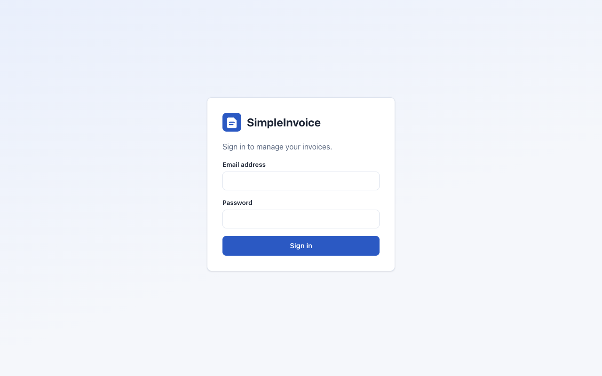
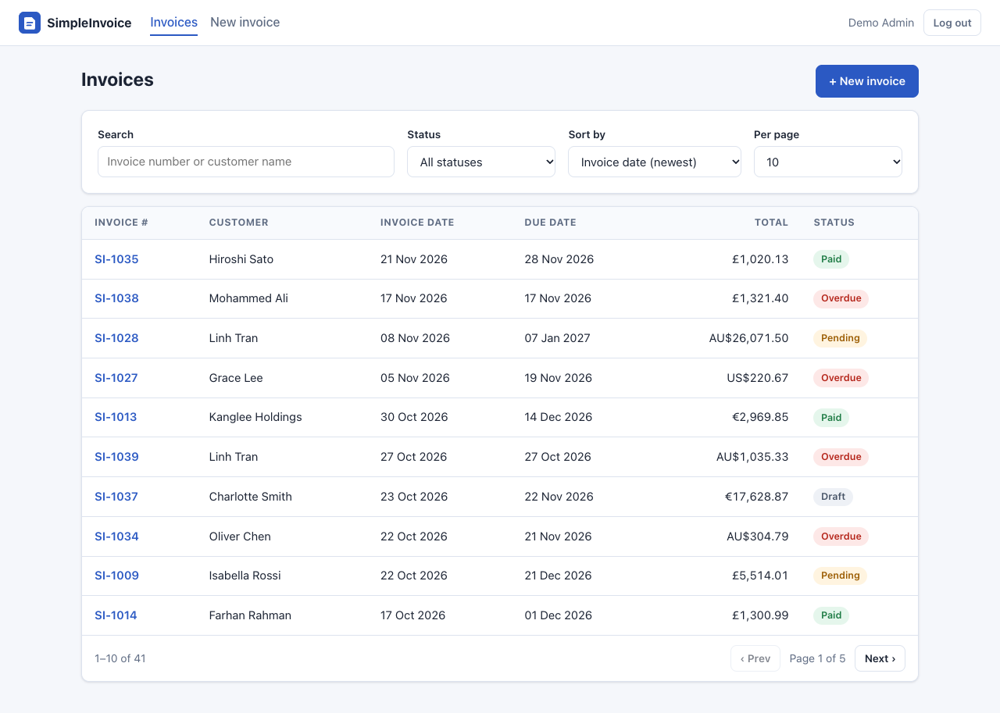
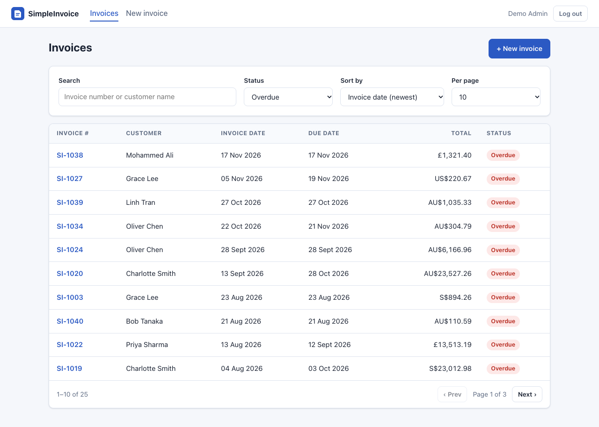
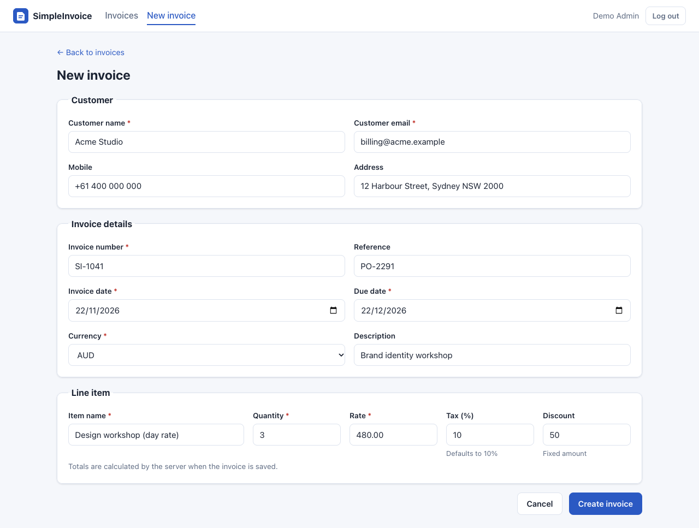
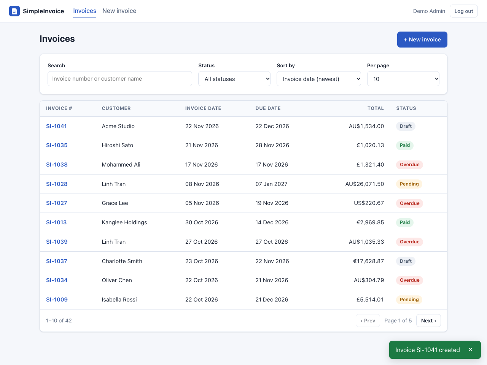
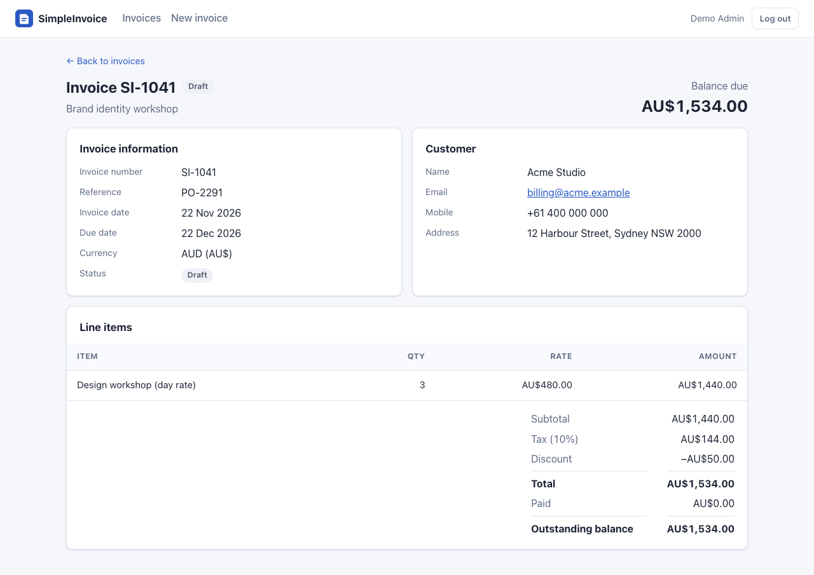
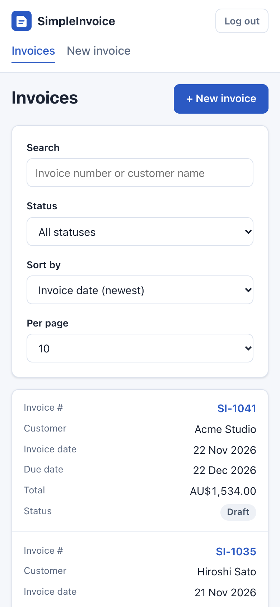
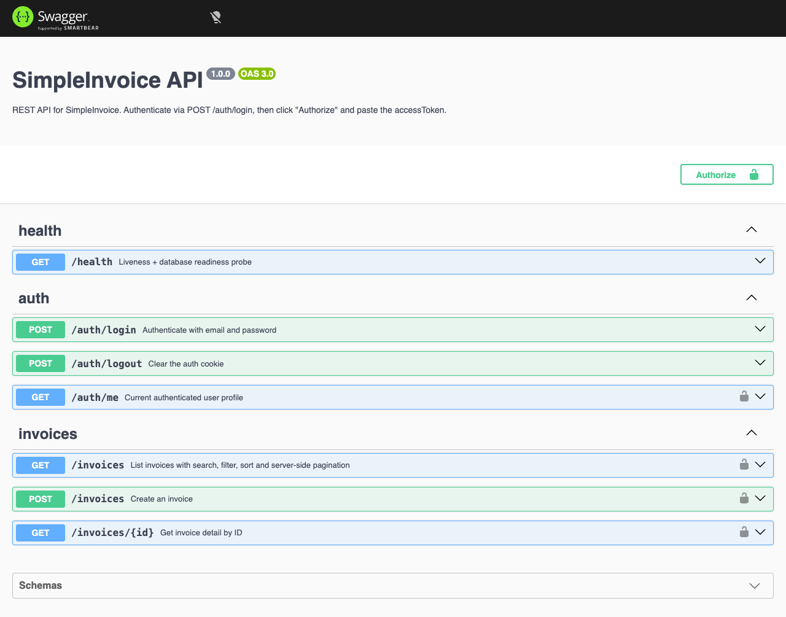

# SimpleInvoice

[](https://github.com/vuminhkhoi1802/simple-invoice/actions/workflows/ci.yml)

A full-stack invoicing app: a **React + TypeScript** SPA, a **NestJS** REST API and **PostgreSQL**.
Users sign in, browse invoices (search, filter, sort, server-side pagination), open an invoice's details and create new invoices. All totals are calculated on the server.

| | |
|---|---|
| **Frontend** | React 19, TypeScript, Vite, React Router, TanStack Query, React Hook Form + Zod |
| **Backend** | NestJS 11, TypeORM 0.3, class-validator, JWT, Swagger (`@nestjs/swagger`) |
| **Database** | PostgreSQL 16 (schema managed by migrations) |
| **Tests** | Jest + Supertest (backend unit + e2e against real Postgres), Vitest + Testing Library (frontend) |

---

## Quick start (Docker, one command)

Requires Docker with Compose v2.

```bash
docker compose up --build
```

The legacy `docker-compose up --build` works too.

That's it: no `.env` file needed. On first boot the backend applies migrations and seeds the database.

| Service | URL | Notes |
|---|---|---|
| **Web app** | http://localhost:8080 | nginx serving the SPA; proxies `/api/*` to the backend |
| **API** | http://localhost:3000 | NestJS |
| **Swagger UI** | http://localhost:3000/api/docs | OpenAPI JSON at `/api/docs-json` |
| **PostgreSQL** | localhost:5432 | user `postgres` / password `postgres`, db `simple_invoice` |

Host ports can be changed with `FRONTEND_HOST_PORT`, `BACKEND_HOST_PORT` and `DB_HOST_PORT` (see the root [`.env.example`](.env.example)).

### Default login

| Email | Password |
|---|---|
| `admin@simpleinvoice.dev` | `Password123!` |

These come from `SEED_USER_EMAIL` / `SEED_USER_PASSWORD`. The seed upserts this user, so the credentials above always work after a seed run.

To reset everything: `docker compose down -v && docker compose up --build`.

---

## Screenshots

Captured from the Docker stack (`docker compose up --build`) at commit `061fb48` on a freshly seeded database, signed in with the [default login](#default-login). They follow one flow: sign in, browse, filter, create an invoice, open it.

**1. Sign in**



**2. Invoice list**: all 41 seeded invoices, 10 per page, with search, status filter, sort and pagination.



**3. Overdue filter** (`?status=overdue`): 25 of the 41 invoices. Overdue is calculated when an invoice is read and never stored.



**4. Create an invoice**: one line item (3 × 480.00), 10% tax and a 50.00 discount. The browser only sends these inputs; the server computes the totals.



**5. Created**: a confirmation toast, and the new invoice is the first row of the list (42 invoices now).



**6. Invoice detail**: AU$1,440.00 subtotal + AU$144.00 tax − AU$50.00 discount = AU$1,534.00 total, as calculated by the server.



**7. Mobile (390 px wide)**: the filters stack and the table becomes cards.



**8. API docs**: Swagger UI at http://localhost:3000/api/docs.



---

## Running locally without Docker

Requires Node.js ≥ 20 (22 recommended) and a PostgreSQL ≥ 13 instance.

```bash
# 1. Database (skip if you already have Postgres running)
docker compose up -d db          # or: createdb simple_invoice

# 2. Backend: http://localhost:3000
cd backend
cp .env.example .env             # then set JWT_SECRET (>= 32 chars) and SEED_USER_PASSWORD
npm install
npm run seed                     # applies migrations + seeds data (safe to re-run)
npm run start:dev

# 3. Frontend: http://localhost:5173 (new terminal)
cd frontend
cp .env.example .env             # optional, defaults work
npm install
npm run dev
```

The Vite dev server proxies `/api` to `http://localhost:3000`, so the browser always talks to a single origin, the same way it does behind nginx in Docker.

### Seeding

```bash
cd backend && npm run seed                          # local
docker compose exec backend npm run seed:prod       # inside the running container
```

The seed script:

- runs pending migrations first, so it works on an empty database;
- upserts the default user, reusing the `createdBy` id from Appendix A (`ad1e0902-…`);
- inserts the **Appendix A** invoice verbatim, except for its status (see *Design decisions*);
- generates **40 more invoices** with a fixed-seed PRNG, covering 16 customers, 10 products, 5 currencies and a mix of Draft, Pending and Paid. Dates are placed relative to the current day, so every run has upcoming, due-today and overdue invoices;
- is **idempotent**: invoices are matched by invoice number and never duplicated.

### Tests

```bash
cd backend
npm test             # unit tests (80): calculator, Overdue rule, validation, uniqueness, auth, guard, error filter
npm run test:e2e     # e2e (26) against real Postgres; DB `simple_invoice_test` on localhost (override via DB_* env)
npm run lint && npm run typecheck

cd frontend
npm test             # component/flow tests (21): login, route guard, list, detail, create
npm run lint
```

The e2e suite **drops and re-creates** the schema of the target database. It runs against `simple_invoice_test`, never your dev DB, unless you override `E2E_DB_NAME`.

CI (`.github/workflows/ci.yml`) runs lint, typecheck, unit and e2e tests with a Postgres service container. It then brings the whole stack up with `docker compose up --build --wait` and smoke-tests the security headers, login and listing through the nginx proxy.

---

## Architecture

```
simple-invoice/                  # monorepo: one clone, one compose file, atomic API+UI changes
├── backend/                     # NestJS API
│   ├── src/
│   │   ├── auth/                # login/logout/me, global JWT guard (secure-by-default), rate limiting
│   │   ├── invoices/
│   │   │   ├── domain/          # pure business logic: totals calculator, Overdue derivation, currencies
│   │   │   ├── dto/             # request/response DTOs + custom validators (IsOnOrAfter, IsIsoDate)
│   │   │   ├── entities/        # TypeORM entities
│   │   │   └── invoices.*.ts    # controller / service / mapper
│   │   ├── users/
│   │   ├── database/
│   │   │   ├── migrations/      # schema source of truth (synchronize is OFF)
│   │   │   └── seed/
│   │   ├── common/              # exception filter, Clock service, decorators, utils
│   │   ├── config/              # env schema, validated at boot (fail fast)
│   │   └── health/              # GET /health (liveness + DB check)
│   └── test/                    # e2e tests
├── frontend/                    # React SPA
│   └── src/
│       ├── api/                 # axios client, typed endpoints, error normalisation
│       ├── auth/                # AuthContext (session via /auth/me), ProtectedRoute
│       ├── pages/               # Login, InvoiceList, InvoiceDetail, CreateInvoice
│       ├── components/          # Layout, Toast, Pagination, StatusBadge, …
│       └── hooks/               # URL-synced list params, debounce
├── docker-compose.yml           # db + backend + frontend
└── .github/workflows/ci.yml
```

**Request flow (Docker):** browser → nginx `:8080` → `/api/*` is proxied, with the prefix stripped, to Nest `:3000` → PostgreSQL. Serving the API and the SPA from one origin removes CORS from the picture and lets the auth cookie be `SameSite=Strict`.

### API

| Method | Endpoint | Auth | Description |
|---|---|---|---|
| POST | `/auth/login` | – | Returns `{ accessToken, tokenType, expiresIn, user }` and sets an httpOnly cookie |
| POST | `/auth/logout` | – | Clears the auth cookie |
| GET | `/auth/me` | ✓ | Current user profile |
| GET | `/invoices` | ✓ | `page`, `pageSize` (≤100), `sortBy` (`invoiceDate`\|`dueDate`\|`totalAmount`), `ordering` (`ASC`\|`DESC`), `status` (`Draft`\|`Pending`\|`Paid`\|`Overdue`), `keyword`, `fromDate`, `toDate` → `{ data, paging: { page, pageSize, total, totalPages } }` |
| GET | `/invoices/:id` | ✓ | Invoice detail (400 for a non-UUID id, 404 if missing) |
| POST | `/invoices` | ✓ | Create invoice → `201` with the detail body; `409` for a duplicate number |
| GET | `/health` | – | `{ status, database }` |

Every error has the shape `{ statusCode, message, error }`. `message` is an array for validation errors. Full schemas, examples and status codes are in Swagger: log in via `POST /auth/login`, click **Authorize** and paste the `accessToken`.

Example create payload:

```json
{
  "invoiceNumber": "INV-2026-0100",
  "invoiceDate": "2026-06-03",
  "dueDate": "2026-07-03",
  "currency": "AUD",
  "customer": { "fullname": "Paul", "email": "paul@101digital.io" },
  "items": [{ "name": "Honda RC150", "quantity": 2, "rate": 1000 }],
  "taxRate": 10,
  "discount": 20
}
```

### Database schema

- **users**: `id uuid PK`, `email` (unique, lowercase enforced by a CHECK), `password_hash` (bcrypt), `fullname`, `created_at`.
- **invoices**: invoice fields + embedded `customer_*` columns + money columns as `NUMERIC(14,2)` + `created_by → users.id`.
  - The `invoice_status` enum holds only **Draft / Pending / Paid**, so the database cannot store `Overdue`.
  - Unique index on `lower(invoice_number)`: uniqueness is enforced by the database and is case-insensitive.
  - CHECK constraints: `due_date >= invoice_date`, non-negative amounts, `total = subtotal + tax − discount`, `balance = total − paid`, currency format.
  - Indexes: `(status, due_date)` for status/Overdue filters; `invoice_date`, `due_date` and `total_amount` for sorting; `created_by`; **pg_trgm GIN** indexes on `invoice_number` and `customer_fullname`, so the `ILIKE '%term%'` search can use an index.
- **invoice_items**: `invoice_id → invoices.id ON DELETE CASCADE`, `name`, `quantity > 0`, `rate > 0`, `amount`, `position`.

---

## Design decisions & assumptions

1. **Monorepo.** One clone, one `docker compose up`, and API and UI changes ship in a single commit.
2. **Customer data is embedded in the invoice** (`customer_*` columns), not kept in a separate table. An invoice is a snapshot of who was billed when it was issued, so changing a customer later must not rewrite history. The spec also has no customer-management feature. If one is added later, a `customers` table can be introduced while the invoice keeps its snapshot columns.
3. **Overdue is derived, never stored.** `deriveInvoiceStatus()` applies the spec rule (`status != Paid && dueDate < today`) when an invoice is read. The `status` list filter turns the same rule into SQL:
   - `Overdue` means `status <> 'Paid' AND due_date < today`.
   - `Pending` and `Draft` exclude overdue rows.

   Both paths get "today" from one injectable `ClockService`, in the timezone set by `APP_TIMEZONE`, so a row's displayed status always matches the filter that returned it. A Draft past its due date is also shown as Overdue, which is what the spec's rule says literally.
4. **Appendix A's `"status": "Overdue"` is stored as `Pending`.** The spec forbids persisting Overdue, and the record has a partial payment. Its due date (2026-07-03) has passed, so it still reads back as **Overdue**.
5. **Money uses exact decimals.** Calculations use `decimal.js`, round half-up to cents at each step and are stored as `NUMERIC(14,2)`, so the stored parts always add up exactly to the stored total. A DB CHECK backs this up. `discount` is an **absolute amount**, matching Appendix A (20.00 on 2000.00) and the formula `total = subTotal + tax − discount`. A discount larger than subtotal + tax is rejected with 400.
6. **Tax is a percentage**, sent as `taxRate` (default 10) and stored per invoice. Responses include both `taxRate` and the computed `totalTax`.
7. **Exactly one line item per invoice.** The API accepts `items: [...]` and validates its length is 1. The schema, calculator and UI mapping already handle many items, so lifting the limit means changing the validator and the form.
8. **Currencies are limited to two-decimal ISO 4217 codes**: AUD, USD, GBP, EUR, SGD, NZD and CAD. The server derives `currencySymbol` (`AUD → AU$`). Currencies like JPY need per-currency precision, which is out of scope.
9. **Invoice numbers** are user-provided, trimmed, limited to `[A-Za-z0-9-_/#.]` and unique regardless of case. The service doesn't pre-check (that would be racy). It maps the database's unique violation (SQLSTATE `23505` on `uq_invoices_invoice_number`) to **409 Conflict**.
10. **All invoices are visible to every authenticated user.** The spec describes the list as "all available invoices within the system". `created_by` is recorded, so per-user or tenant scoping is a single `WHERE` clause away.
11. **Auth tokens.** `POST /auth/login` returns the JWT (HS256, lifetime `JWT_EXPIRES_IN`, default 3600 s) in the body for API clients and Swagger. It also sets the token as an **httpOnly, SameSite=Strict** cookie (`Secure` when `COOKIE_SECURE=true`). The SPA relies on the cookie and never touches the token, so an XSS bug cannot read it from `localStorage`. The guard accepts either `Authorization: Bearer` or the cookie. Strict SameSite, JSON-only bodies and same-origin serving together mitigate CSRF.
12. **Secure by default.** The JWT guard is registered globally, so only routes marked `@Public()` (login, logout, health) skip it. Other measures:
    - login responses are the same for an unknown email and a wrong password, and both take the same time (a dummy bcrypt compare runs when the email is unknown);
    - login is rate-limited per IP (10/min by default);
    - `helmet` sets security headers;
    - the ValidationPipe uses `whitelist` + `forbidNonWhitelisted`, so a client cannot sneak in `status` or `totalAmount`.
13. **Configuration is validated at boot.** A missing `JWT_SECRET`, a secret shorter than 32 characters or an unknown timezone crashes startup with a clear message instead of failing later at runtime.
14. **Docker defaults are dev-only.** `docker-compose.yml` falls back to development values (DB password, JWT secret, seed password) so a reviewer can start the stack with one command and no setup. Nothing secret is hard-coded in application code: every value comes from the environment. Override them through `.env` for any real deployment.
15. **List state lives in the URL** (`?status=Paid&sortBy=totalAmount…`), so refresh, the back button and shared links all keep the current view. Search is debounced (350 ms).
16. **Client and server validation** follow the same rules (Zod in the browser, class-validator on the API). The server stays the authority: the form never computes totals.

## Known limitations

- **No payment recording or status transitions.** There are no endpoints to mark invoices Pending or Paid or to record payments. Seeded data covers those states, but new invoices stay Draft, which is all the spec covers.
- **No update or delete for invoices**, and no user registration (single seeded account).
- **No refresh tokens or token revocation.** Sessions end when the access token expires. Logout clears the cookie, but a copied bearer token stays valid until it expires.
- **Rate limiting is in-memory** (per instance). Running multiple API replicas would need a shared store such as Redis.
- **"Today" comes from a single server timezone** (`APP_TIMEZONE`, default UTC). It does not follow each viewer's local timezone, so near midnight an invoice can show as Overdue a few hours earlier or later than a user expects.
- **Migrations run automatically on boot**, which suits a single-instance deployment. With several replicas you'd run them as a separate release step.
- The SPA is not code-split (about 150 kB gzipped), which is fine at this size.
